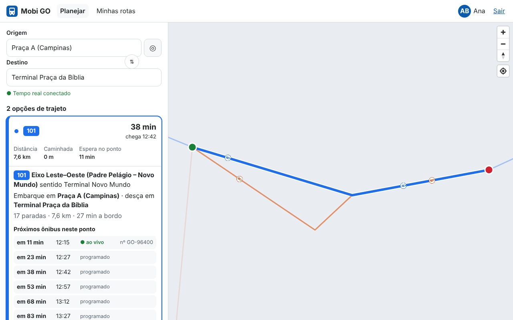
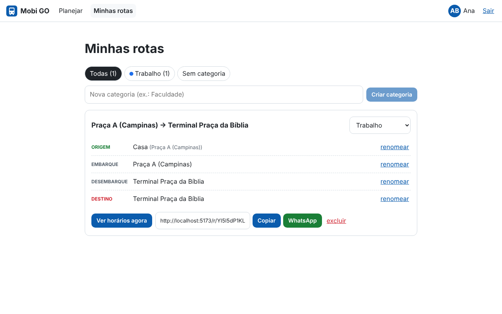
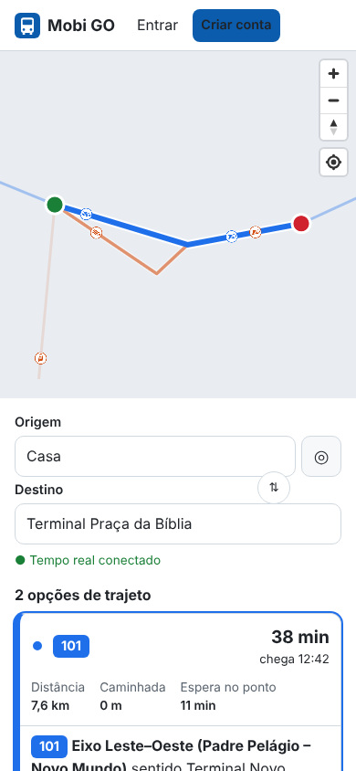

# Mobi GO

**Planejamento de viagens de ônibus com tempo real para o estado de Goiás.**

Qualquer pessoa em Goiás pode criar uma conta, colocar foto de perfil, consultar **todas as linhas** que fazem o seu trajeto (cada opção com **cor própria**, **quilometragem**, **tempo até o destino** e **tempo de espera de cada ônibus**) e ver os **ônibus andando sobre a linha no mapa em tempo real**. Também pode **salvar rotas em categorias**, **dar nomes próprios aos pontos** ("Casa", "Ponto da padaria") e **compartilhar** por link ou WhatsApp.

| Consulta com ônibus ao vivo | Rotas salvas e compartilhamento | Celular |
|---|---|---|
|  |  |  |

<sub>Capturas do ambiente de desenvolvimento com o GTFS sintético. O mapa aparece com o estilo de contingência (sem mapa base) porque o servidor de tiles estava inacessível na captura: rotas, pontos e ônibus continuam visíveis por design.</sub>

> ⚠️ **Dados de demonstração:** o repositório inclui um gerador de GTFS **sintético** de Goiânia (marcos aproximados reais, linhas e horários fictícios) e um simulador de frota GTFS-Realtime. A integração com os dados oficiais da CMTC e das operadoras depende de acordo de dados (ver [visão do produto](docs/01-visao-do-produto.md#7-premissas-e-riscos)).

## Arquitetura em um parágrafo

App web **React + MapLibre** → API **Fastify (Node 22, TypeScript)** → **PostgreSQL 16 + PostGIS** (GTFS, contas, rotas; **TimescaleDB** para o histórico de GPS) e **Redis** (estado quente dos veículos e pub/sub). Um **ingestor GTFS-RT** limpa o GPS (projeção no traçado, descarte de saltos, sem ré, *dead reckoning*) e publica no Redis. Cada instância da API distribui as posições por **Server-Sent Events**. O planejamento usa um **planejador interno de linhas diretas** e, opcionalmente, o **OpenTripPlanner** para baldeações. Mapa base, geocodificação e roteamento são **próprios**, sem custo por requisição. Detalhes e diagramas: [docs/03-arquitetura.md](docs/03-arquitetura.md).

```
apps/
  api/        API REST + SSE, workers (ingestor GTFS-RT, simulador), scripts (migração, carga GTFS)
  web/        App web (React, MapLibre, animação dos ônibus)
packages/
  shared/     Geometria, ETA, cores e contratos — o mesmo código no servidor e no navegador
db/migrations Esquema SQL (PostGIS, Timescale opcional)
infra/        Nginx, OpenTripPlanner
docs/         Documentação do ciclo de vida + ADRs
tests/load/   Teste de carga k6
```

## Começando

```bash
docker compose up --build          # tudo em contêineres → http://localhost:8080
```

Ou, sem Docker (Node ≥ 22, pnpm 10, PostgreSQL com PostGIS e Redis). O passo a passo completo, com instalação no Windows, Linux e macOS e uma introdução ao Redis, está em **[docs/10-guia-ambiente-local.md](docs/10-guia-ambiente-local.md)**:

```bash
pnpm install && pnpm --filter @mobigo/shared build
pnpm db:migrate
pnpm --filter @mobigo/api exec tsx src/scripts/generate-sample-gtfs.ts
pnpm gtfs:load -- --vehicle-positions-url http://localhost:8090/gtfs-rt/vehicle-positions
# depois, um comando por terminal:
pnpm dev:simulator
pnpm --filter @mobigo/api ingestor
pnpm dev:api
pnpm dev:web                       # → http://localhost:5173
```

Testes (63 entre unitários e integração contra PostGIS e Redis reais):

```bash
pnpm typecheck && pnpm test
```

## Documentação

| # | Documento | Conteúdo |
|---|---|---|
| 01 | [Visão do produto](docs/01-visao-do-produto.md) | Contexto em Goiás, problema, personas, KPIs, escopo, riscos |
| 02 | [Requisitos](docs/02-requisitos.md) | RF/RNF, histórias com critérios de aceite (Gherkin), rastreabilidade |
| 03 | [Arquitetura](docs/03-arquitetura.md) | C4, fluxos, falhas de GPS, capacidade, alta disponibilidade, custos |
| 04 | [Modelo de dados](docs/04-modelo-de-dados.md) | ER, GTFS e padrões de parada, Redis, retenção |
| 05 | [API](docs/05-api.md) | Endpoints, contratos, SSE, erros |
| 06 | [Segurança e LGPD](docs/06-seguranca-e-lgpd.md) | Ameaças, controles, inventário de dados, direitos do titular |
| 07 | [Plano de testes](docs/07-plano-de-testes.md) | Estratégia, cobertura, E2E, carga, DoD |
| 08 | [Implantação e operação](docs/08-implantacao-e-operacao.md) | Ambientes, produção, GTFS/OSM/OTP, SLOs, runbooks, backup |
| 09 | [Roadmap](docs/09-roadmap.md) | Fases, backlog, equipe, ritos |
| 10 | [Guia do ambiente local](docs/10-guia-ambiente-local.md) | Instalar pnpm, PostGIS e Redis; primeiros passos com Redis; problemas comuns |
| — | [ADRs](docs/adr/) | Decisões de arquitetura |
| — | [Contribuindo](CONTRIBUTING.md) | Fluxo de trabalho e padrões |
