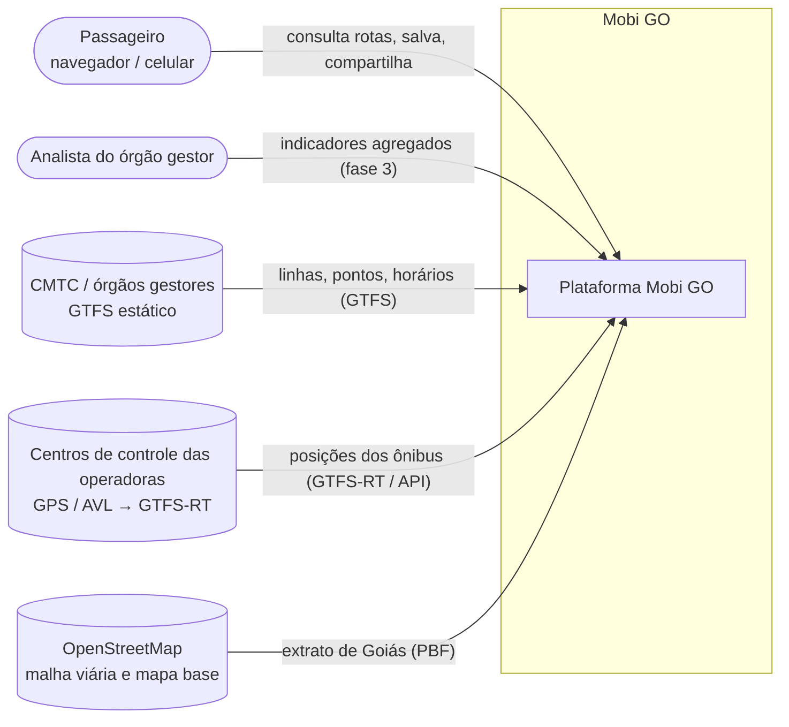
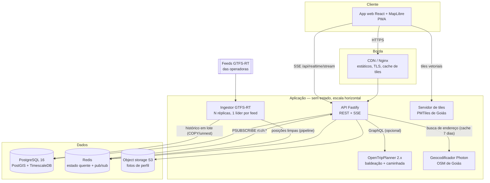
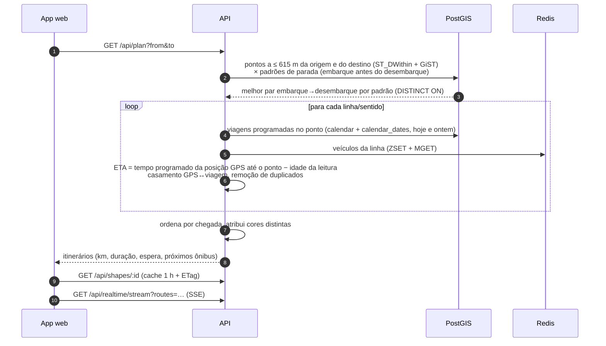
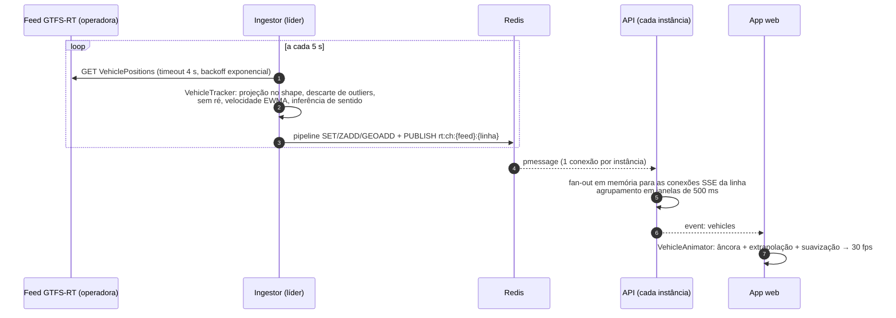

# 03 — Arquitetura

## 1. Visão geral (C4 — Contexto)

## 2. Contêineres (C4 — nível 2)

| Contêiner | Tecnologia | Responsabilidade | Escala |
|---|---|---|---|
| App web | React 18, Vite, MapLibre GL | UI, animação dos ônibus, cache de shapes | CDN |
| API | Node 22, Fastify 5, Zod | Autenticação, rotas salvas, planejamento, SSE | Horizontal (sem estado) |
| Ingestor | Node 22 | Lê GTFS-RT, limpa o GPS, publica no Redis, grava o histórico | 1 líder ativo por feed + standby |
| Simulador | Node 22 | Feed GTFS-RT sintético a partir do GTFS (dev/homologação) | — |
| OTP | OpenTripPlanner 2.6 | Itinerários com baldeação | Réplicas com grafo em memória |
| PostgreSQL | PG16 + PostGIS 3 + TimescaleDB | Fonte da verdade: usuários, GTFS, histórico | Primário + réplicas de leitura |
| Redis | Redis 7 | Última posição por veículo, pub/sub, *rate limit*, cache de geocodificação | Réplica + Sentinel |
| Object storage | S3/MinIO/R2 | Fotos de perfil (chaves imutáveis) | Gerenciado |

## 3. Fluxos principais

### 3.1 Consulta de rota

### 3.2 Pipeline de tempo real

### 3.3 Tratamento de falhas de GPS (ver ADR 0007)

```mermaid
stateDiagram-v2
  [*] --> AoVivo: leitura válida
  AoVivo --> AoVivo: nova leitura (≤ 60 s)
  AoVivo --> Estimado: sem leitura há > 60 s
  Estimado --> AoVivo: leitura volta (correção suave; > 600 m = reposiciona)
  Estimado --> Programado: sem leitura há > 5 min (veículo removido)
  Programado --> AoVivo: veículo volta a reportar
  note right of Estimado
    posição = última + velocidade típica × tempo
    ícone semitransparente, ETA marcada "estimado"
  end note
```

Proteções no ingestor contra leituras ruins:

| Situação | Detecção | Ação |
|---|---|---|
| Ruído de 10–50 m | — | projeção no shape (a posição publicada fica sempre sobre a via) |
| Reflexo / leitura fora da via | desvio > 120 m do shape | descarta |
| Salto impossível | avanço > 30 m/s | descarta |
| "Andar para trás" | distância < anterior | mantém a máxima já atingida |
| Duplicada / fora de ordem | timestamp ≤ anterior | descarta |
| Sem `trip_id` | — | escolhe o shape da linha mais próximo, desempate pelo sentido do movimento |
| Feed fora do ar | erro HTTP / timeout | backoff exponencial até 60 s; ETA cai para *dead reckoning* e depois para o programado |

## 4. Decisões de arquitetura (ADRs)

| ADR | Decisão |
|---|---|
| [0001](adr/0001-monorepo-typescript.md) | Monorepo TypeScript (API, workers, web e pacote compartilhado) |
| [0002](adr/0002-banco-de-dados.md) | PostgreSQL + PostGIS (+ TimescaleDB) como fonte da verdade; Redis para o estado quente |
| [0003](adr/0003-mapas-e-custos.md) | MapLibre + tiles próprios; geocodificador próprio; nada pago por requisição |
| [0004](adr/0004-planejador.md) | Planejador interno de linhas diretas no MVP, OpenTripPlanner para baldeação |
| [0005](adr/0005-tempo-real-sse.md) | Server-Sent Events com fan-out via Redis, *polling* como fallback |
| [0006](adr/0006-autenticacao.md) | Argon2id + JWT curto em memória + refresh token rotativo em cookie httpOnly |
| [0007](adr/0007-eta-e-gps.md) | ETA pelo tempo de percurso programado a partir da posição real; *dead reckoning* limitado |

## 5. Capacidade e dimensionamento

Premissas a validar na Fase 0:

| Grandeza | Premissa | Carga resultante |
|---|---|---|
| Frota rastreada no estado | 3.000 veículos | 300 leituras/s com 1 leitura a cada 10 s (dimensionado para 1.500/s) |
| Usuários ativos diários | 50 mil | pico de ~6 mil consultas/min no rush |
| Conexões SSE simultâneas | 10 mil (pico) | ~2 instâncias da API com 5 mil conexões cada, mais folga |
| Histórico de posições | 300 leituras/s × 86.400 s | ~26 milhões de linhas/dia, ~1,5 GB/dia bruto; após a compressão Timescale, ~10–15× menos; retenção de 180 dias |

Por que isso escala:
- **O caminho quente não toca o banco:** posições ficam no Redis, e os shapes e padrões de parada ficam em memória (`FeedCache`).
- **Uma conexão Redis por instância** da API (PSUBSCRIBE) e fan-out em memória. Não há uma conexão por cliente.
- **A consulta de rota usa padrões de parada** (milhares de linhas), não `stop_times` (milhões).
- **A API não tem estado**: qualquer instância atende qualquer requisição, inclusive a reconexão SSE.

## 6. Alta disponibilidade e degradação graciosa

| Falha | Comportamento |
|---|---|
| Redis indisponível | Consultas seguem com horário programado; *rate limit* falha aberto (`skipOnError`); SSE reconecta |
| Ingestor líder cai | Lock expira em 15 s, a réplica standby assume |
| Feed GTFS-RT fora do ar | Ônibus passam a "estimado" e depois somem; ETAs voltam ao programado |
| OTP indisponível | `OtpPlanner` cai para o planejador interno de linhas diretas |
| Servidor de tiles fora do ar | O mapa usa o estilo de contingência: rotas, pontos e ônibus continuam visíveis |
| Rede do cliente bloqueia SSE | Após 3 falhas, *polling* a cada 10 s |
| Primário do PostgreSQL cai | Failover gerenciado (Patroni/serviço gerenciado). Durante o failover, as leituras de horário falham por segundos; a SSE continua via Redis |

## 7. Estratégia de custos de terceiros

| Item | Alternativa paga típica | Escolha | Observação |
|---|---|---|---|
| Mapa base | Mapbox / Google Maps (cobrança por carregamento) | Tiles vetoriais OSM próprios (PMTiles) servidos por CDN | Custo fixo de armazenamento e banda |
| Geocodificação | Google Geocoding (por requisição) | Photon/Nominatim com OSM de Goiás + cache de 7 dias no Redis | Pontos de ônibus buscados direto no PostGIS |
| Rotas | Google Directions (por requisição) | Planejador interno + OpenTripPlanner | Usa o GTFS oficial, mais fiel que provedores genéricos |
| Tempo real | — | Pipeline próprio | — |

Na escala de 50 mil usuários/dia, APIs comerciais cobradas por requisição gerariam custo mensal recorrente proporcional ao uso. Com a infraestrutura própria, o custo vira fixo (servidores), previsível em orçamento público.
