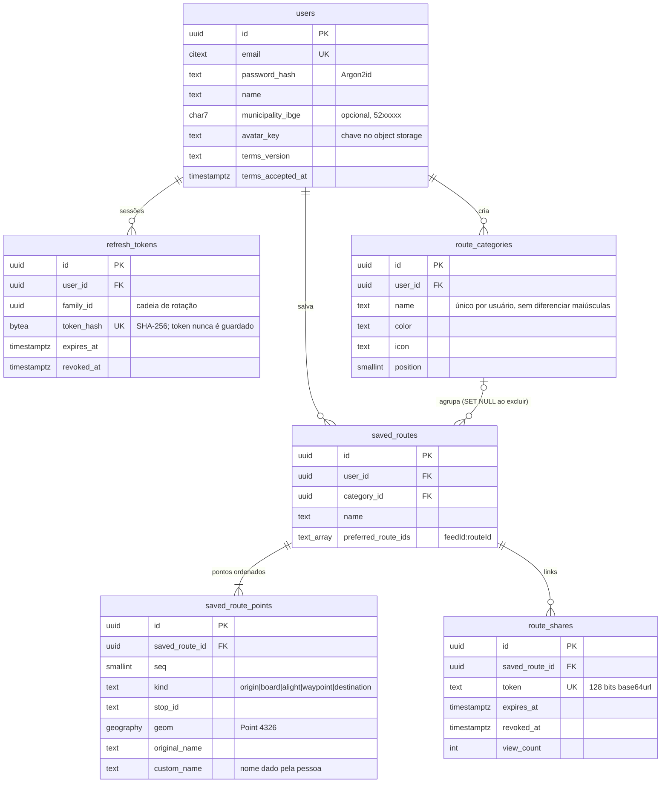
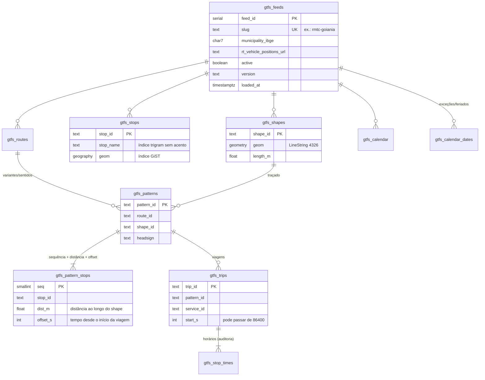

# 04 — Modelo de dados

Esquema completo: [`db/migrations/0001_init.sql`](../db/migrations/0001_init.sql). Migrações são aplicadas em ordem, cada uma em sua transação, com *advisory lock* (seguro com várias réplicas subindo ao mesmo tempo): `pnpm db:migrate`.

## 1. Domínio do usuário

Decisões:
- **`original_name` + `custom_name`**: o nome original nunca se perde, então "voltar ao original" é só `custom_name = NULL`.
- **Pontos como `geography`**: as distâncias ficam em metros, sem reprojeção, e o estado inteiro cabe sem distorção relevante.
- **Compartilhamento por token aleatório**, não por ID: não dá para enumerar, é revogável e pode expirar.
- **Exclusão em cascata** a partir de `users`: a eliminação LGPD é um único `DELETE`.

## 2. Domínio de transporte (GTFS)

### Padrões de parada (*stop patterns*)
O loader agrupa viagens com a **mesma linha, shape, sequência de pontos e offsets relativos** em um padrão. Assim:
- a consulta de rota cruza pontos próximos × `gtfs_pattern_stops` (milhares de linhas), não `stop_times` (milhões);
- o horário de uma viagem em qualquer ponto é `start_s + offset_s`, sem *join* com `stop_times`;
- `dist_m` (referência linear: projeção de cada ponto no shape, sempre à frente do anterior) permite calcular a **quilometragem exata do trecho embarcado** e a **ETA a partir da posição do GPS**.

### Multi-feed e IDs
Cada sistema (RMTC, Anápolis, Rio Verde, intermunicipal) é um `feed`. A API expõe IDs como `"<feedId>:<id>"` (ex.: `1:L101`), porque o mesmo `route_id` pode existir em feeds diferentes.

### Troca de versão do GTFS
O loader apaga e recarrega o feed **em uma única transação**: as consultas em andamento continuam vendo a versão anterior (MVCC) até o `COMMIT`. Os processos detectam a mudança por `gtfs_feeds.loaded_at` e recarregam os caches em até 60 s.

## 3. Telemetria

`vehicle_positions` (hypertable TimescaleDB quando disponível): `ts`, `feed_id`, `vehicle_id`, `trip_id`, `route_id`, `geom`, `distance_along`, `speed_mps`, `bearing`.
- Chunks diários, compressão após 3 dias (`segmentby feed_id, vehicle_id`), retenção de 180 dias.
- Sem TimescaleDB (ex.: RDS), a migração cria uma tabela comum; use `pg_partman` com o mesmo esquema.
- Uso previsto: tempos de percurso históricos por faixa horária (melhora da ETA), indicadores de pontualidade e qualidade do GPS.
- **Não contém dados pessoais**: são posições de veículos, não de pessoas.

## 4. Estado quente no Redis

| Chave | Tipo | TTL | Conteúdo |
|---|---|---|---|
| `rt:v:{feed}:{vehicle}` | string (JSON) | 300 s | último `VehicleUpdate` limpo |
| `rt:trip:{feed}:{trip}` | string | 300 s | veículo que executa a viagem |
| `rt:route:{feed}:{route}` | ZSET | 600 s | veículos da linha, com score = timestamp |
| `rt:geo:{feed}` | GEO | — | posições, para consulta por área |
| canal `rt:ch:{feed}:{route}` | pub/sub | — | cada atualização, para os gateways SSE |
| `lock:ingestor:{feed}` | string | 15 s | liderança do ingestor |
| `geo:q:{consulta}` | string (JSON) | 7 dias | cache do geocodificador |
| `rl:*` | — | 1 min | contadores do *rate limit* |

O Redis roda **sem persistência** (`--save ""`): tudo ali se reconstrói em segundos a partir do próximo ciclo do feed.

## 5. Retenção

| Dado | Retenção | Base |
|---|---|---|
| Conta, rotas, categorias | Enquanto a conta existir | Execução do serviço solicitado (LGPD art. 7º, V) |
| Refresh tokens | 30 dias (expirados podem ser removidos por rotina diária) | Segurança |
| Foto de perfil | Até ser trocada ou removida; a anterior é apagada na troca | Consentimento (ato de enviar) |
| Histórico de posições de veículos | 180 dias | Interesse público, sem dado pessoal |
| Logs de acesso (sem corpo de requisição) | 6 meses | Marco Civil da Internet, art. 15 |
