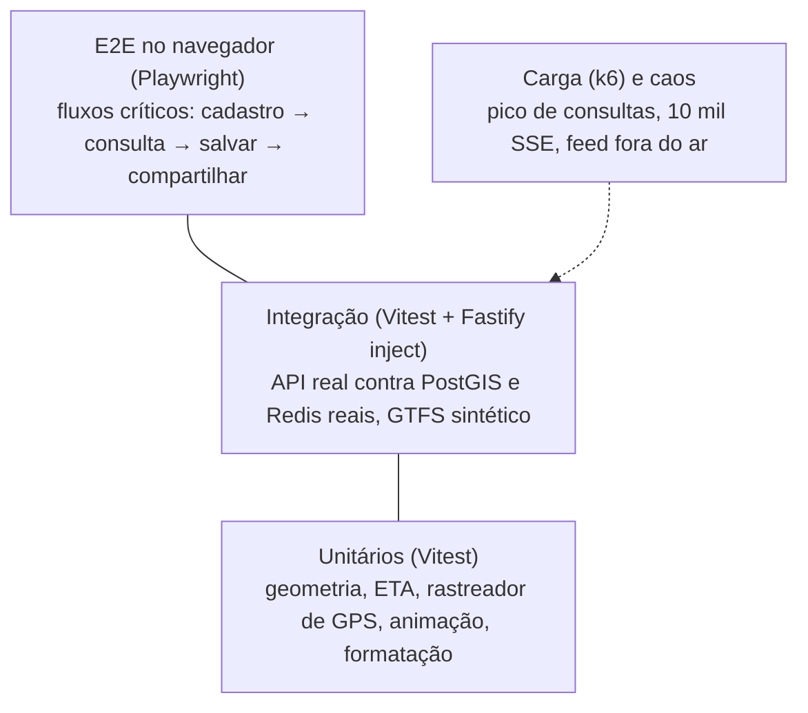

# 07 — Plano de testes e qualidade

## 1. Estratégia



| Nível | Ferramenta | Onde | Roda em |
|---|---|---|---|
| Unitário | Vitest | `packages/shared/src/*.test.ts`, `apps/api/src/**/*.test.ts`, `apps/web/src/**/*.test.ts` | Todo commit (CI) |
| Integração | Vitest + `app.inject` + PostGIS + Redis reais | `apps/api/test/*.test.ts` | Todo commit (CI com *service containers*) |
| E2E | Playwright | roteiro da seção 3 | Antes de cada release (homologação) |
| Carga | k6 | [`tests/load/plan-and-stream.k6.js`](../tests/load/plan-and-stream.k6.js) | Antes do lançamento e a cada mudança no planejador |
| Acessibilidade | axe + leitor de tela (NVDA/TalkBack) | telas principais | Antes de cada release |

Integração **sem mocks de banco**: o `global-setup` aplica as migrações, gera o GTFS sintético e o carrega com o loader de produção. Assim, cada execução também testa o loader e as consultas PostGIS reais.

## 2. Cobertura atual (63 testes automatizados)

| Suíte | Testes | O que garante |
|---|---|---|
| `shared/geo.test.ts` | 11 | Haversine, interpolação e rumo, projeção de GPS no traçado, janela de busca, **projeção monotônica em linha de ida e volta**, polyline, limites de Goiás |
| `shared/eta.test.ts` | 12 | ETA ao vivo, *dead reckoning*, descarte após 5 min, veículo que já passou, tempo programado a partir da posição, EWMA, horários > 24h, paleta de cores |
| `api/realtime/tracker.test.ts` | 5 | GPS projetado na via, descarte de leitura fora da via, duplicada e salto; sem ré; **inferência de sentido sem `trip_id`** |
| `api/workers/simulator.test.ts` | 2 | Progresso temporal da viagem |
| `api/test/auth.test.ts` | 6 | Cadastro, validações, login sem enumeração, **rotação e detecção de reuso de refresh token**, logout, rotas protegidas |
| `api/test/me.test.ts` | 4 | Perfil, **foto em WebP 512 px sem EXIF**, recusa de arquivo falso, exportação e exclusão (LGPD) |
| `api/test/saved-routes.test.ts` | 7 | Categorias (CRUD, unicidade, exclusão sem perder rotas, filtro), pontos personalizados, validações, **IDOR**, compartilhamento público, cópia, revogação |
| `api/test/plan.test.ts` | 8 | **Todas as linhas diretas**, cores distintas, km, duração = soma das pernas + espera, ordem, sentido correto, **ETA por GPS**, opção a pé, fora de Goiás, **feriado com tabela de domingo**, pontos próximos, busca sem acento, ETag |
| `web/map/VehicleAnimator.test.ts` | 5 | Filtro por shape, **movimento contínuo entre leituras**, **correção suave sem teleporte**, estado "estimado" e remoção, fim da linha |
| `web/format.test.ts` | 3 | Formatos pt-BR (km, duração, espera) |

Como rodar:
```bash
# requer PostgreSQL com PostGIS e Redis (docker compose up db redis)
createdb mobilidade_test   # uma vez
pnpm --filter @mobigo/shared build
pnpm test
```

## 3. Roteiro E2E (executado no navegador durante o desenvolvimento)

1. `/cadastro`: criar conta com município → redireciona para o início, com o avatar de iniciais no topo.
2. Origem "Praça A", destino "Bíblia" pela busca → 2 opções (linhas 101 e 102) com cores diferentes; status "Tempo real conectado"; pelo menos um ônibus "ao vivo".
3. O mapa mostra os trechos coloridos e os ícones de ônibus se movendo (comparação de dois quadros com 3 s de intervalo).
4. "Salvar esta rota" → nova categoria "Trabalho", origem renomeada "Casa" → "Rota salva!".
5. "Minhas rotas": aba "Trabalho (1)", ponto "Casa (Praça A (Campinas))", botão "Compartilhar" gera o link.
6. Em outra sessão, anônima e em viewport de celular (390×844), o link mostra "Ana compartilhou uma rota com você"; "Ver ônibus em tempo real" abre a consulta.
7. `/perfil`: envio de foto, exportação e exclusão de conta.

Cenários de falha a validar em homologação:
| Cenário | Como provocar | Esperado |
|---|---|---|
| Servidor de tiles fora | bloquear o host do estilo | Estilo de contingência; rotas e ônibus visíveis |
| SSE bloqueado | proxy sem *streaming* | Após 3 falhas: "modo econômico" (*polling* de 10 s) |
| GPS some | `simulator --dropout 0.5` | Ônibus semitransparentes, "estimado"; depois, programado |
| Feed fora do ar | parar o simulador | Log de backoff no ingestor; consulta segue com horário programado |
| Líder do ingestor cai | matar a réplica líder | Outra assume em ≤ 15 s |
| Redis reinicia | `docker restart redis` | API continua respondendo (`/ready` com `redis:false`); tempo real volta sozinho |

## 4. Critérios de pronto (Definition of Done)

- Requisito com critério de aceite (Gherkin) e teste automatizado correspondente.
- `pnpm typecheck` e `pnpm test` verdes no CI.
- Sem dado pessoal novo sem avaliação LGPD ([06](06-seguranca-e-lgpd.md)).
- Telas novas navegáveis por teclado e com contraste AA.
- Documentação atualizada; ADR para decisão de arquitetura.
