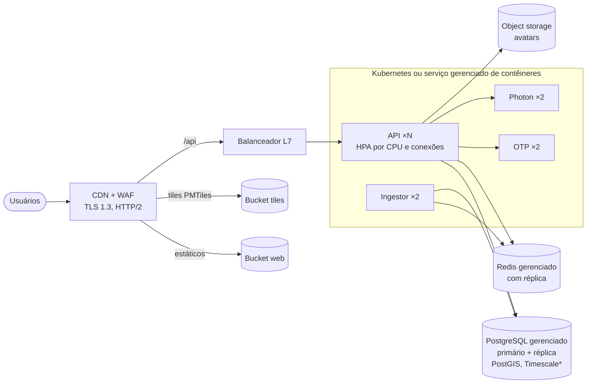

# 08 — Implantação e operação

## 1. Ambientes

| Ambiente | Finalidade | Dados | Tempo real |
|---|---|---|---|
| Local | Desenvolvimento | GTFS sintético | Simulador |
| Homologação | Testes de aceite, carga e E2E | GTFS oficial (cópia) | Feed real em espelho ou simulador |
| Produção | Cidadãos | GTFS oficial | Feeds das operadoras |

## 2. Executar localmente

### Opção A — tudo em contêineres
```bash
docker compose up --build
# web: http://localhost:8080   API: http://localhost:3000   MinIO: http://localhost:9001
```
O serviço `setup` aplica as migrações, gera o GTFS sintético e o carrega. O `simulator` publica GTFS-RT e o `ingestor` (2 réplicas, uma líder) consome.

### Opção B — processos locais (desenvolvimento do código)
```bash
docker compose up -d db redis                 # ou PostgreSQL+PostGIS e Redis locais
pnpm install
pnpm --filter @mobigo/shared build
pnpm db:migrate
pnpm --filter @mobigo/api exec tsx src/scripts/generate-sample-gtfs.ts
pnpm gtfs:load -- --vehicle-positions-url http://localhost:8090/gtfs-rt/vehicle-positions
pnpm dev:simulator      # terminal 1
pnpm --filter @mobigo/api ingestor   # terminal 2
pnpm dev:api            # terminal 3
pnpm dev:web            # terminal 4 → http://localhost:5173
```
Fora do horário de operação (madrugada), use `pnpm dev:simulator -- --time-offset-h=-8` para ver ônibus circulando.

## 3. Produção — topologia recomendada



\* Se o provedor gerenciado não oferecer TimescaleDB, a migração usa tabela comum. Nesse caso, configure `pg_partman` (ADR 0002).

Recomendações:
- **Soberania de dados e custo:** prefira nuvem com região no Brasil ou a infraestrutura do estado. Os contêineres são portáveis.
- **API**: no mínimo 2 réplicas em zonas distintas. O *readiness* usa `/api/ready` e o *liveness* usa `/api/health`. Para SSE, ajuste `terminationGracePeriodSeconds` e o *idle timeout* do balanceador para ≥ 1 h. O cliente reconecta sozinho em deploys.
- **Ingestor**: 2 réplicas. O lock garante 1 líder por feed.
- **Migrações**: um *Job* `node dist/scripts/migrate.js` antes do *rollout*. As migrações devem ser compatíveis com a versão anterior (expandir → migrar → contrair).

### Configuração (variáveis de ambiente)
Ver [`.env.example`](../.env.example) e [`apps/api/src/config.ts`](../apps/api/src/config.ts), que valida tudo na inicialização e falha cedo. Em produção, `JWT_SECRET` é obrigatório (≥ 32 caracteres) e vem do cofre de segredos.

## 4. Dados: GTFS, OSM e OpenTripPlanner

### Atualização do GTFS (a cada nova programação das operadoras)
```bash
unzip gtfs-rmtc-2026-11.zip -d /tmp/gtfs-rmtc
node dist/scripts/load-gtfs.js --slug rmtc-goiania --name "RMTC Goiânia" --ibge 5208707 --dir /tmp/gtfs-rmtc \
  --vehicle-positions-url https://<operadora>/gtfs-rt/vehicle-positions
```
- A troca acontece em uma transação, sem indisponibilidade. Os caches recarregam em ≤ 60 s.
- Antes de publicar, valide o feed com o **MobilityData GTFS Validator** (sem erros bloqueantes).
- Cada município ou sistema é um `--slug` próprio, e os feeds coexistem.

### Mapa base e geocodificação (sem custo por requisição)
1. Baixe o extrato OSM do Centro-Oeste (Geofabrik) e recorte Goiás:
   `osmium extract -p goias.geojson centro-oeste-latest.osm.pbf -o goias.osm.pbf`
2. Gere tiles vetoriais com **Planetiler** em um arquivo **PMTiles** e publique no bucket atrás da CDN. Configure `VITE_MAP_STYLE_URL` com um estilo que aponte para ele.
3. Suba o **Photon** com os dados de Goiás e configure `GEOCODER_URL`.
4. Atualize mensalmente.

### OpenTripPlanner (baldeações)
1. Copie `goias.osm.pbf` e o GTFS (`gtfs-rmtc.zip`) para `infra/otp/`. Em `build-config.json`, o `feedId` **deve** ser o `feed_id` numérico do banco.
2. `docker compose --profile otp up otp` (o grafo é construído na primeira execução, com cerca de 6 GB de RAM).
3. Configure `OTP_URL=http://otp:8080` na API. Se o OTP cair, a API volta sozinha ao planejador de linhas diretas.

## 5. Observabilidade

### SLOs
| SLO | Meta | Medição |
|---|---|---|
| Disponibilidade de `/api/plan` | 99,5%/mês | Respostas não 5xx / total |
| Latência de `/api/plan` | p95 < 400 ms | Histograma por rota |
| Frescor do tempo real | 95% dos veículos ativos com leitura < 30 s | `now - timestamp` no Redis |
| Precisão da ETA | Erro mediano ≤ 90 s (a até 10 min) | Comparar a previsão com a passagem observada no histórico |

### Métricas e alertas
| Sinal | Fonte | Alerta |
|---|---|---|
| Publicados e rejeitados por motivo, por feed | Log do ingestor a cada 60 s (exportar para Prometheus) | `published == 0` por 3 min em horário de operação; `off_route / total > 20%` (shape errado no GTFS ou GPS ruim) |
| Falhas de leitura do feed | Log `falha na leitura` | 5 falhas seguidas |
| 5xx, latência | Logs Fastify (`responseTime`) | Taxa de 5xx > 1% em 5 min |
| Conexões SSE | `hub.connectionCount` | Acima de 80% da capacidade planejada |
| Banco | Métricas do provedor | CPU > 70%, *replication lag* > 10 s |
| Redis | Métricas do provedor | Memória > 75% |

Logs estruturados (JSON/pino) **sem dados pessoais**: `authorization`, `cookie` e `set-cookie` são removidos.

## 6. Runbooks

**Ônibus sumiram do mapa (feed X)**
1. Log do ingestor: há `falha na leitura`? Teste a URL do feed manualmente.
2. Se o feed responde, compare `publicados` e `rejeitados`. `unknown_trip` alto indica GTFS-RT com `trip_id` de outra versão do GTFS: recarregue o GTFS vigente.
3. `off_route` alto indica shapes desatualizados ou feed com lat/lon trocados.
4. Enquanto isso, o app segue funcionando com horário programado.

**Previsões erradas em uma linha**
1. Compare `gtfs_pattern_stops.offset_s` com os tempos observados em `vehicle_positions`.
2. Se a programação está desatualizada, peça um novo GTFS. Evolução: ETA com tempos históricos (roadmap).

**Pico de 401 / possível ataque**
1. Verifique o *rate limit* (429) e a origem no WAF.
2. Se houver comprometimento: revogue sessões e gire o `JWT_SECRET` ([06](06-seguranca-e-lgpd.md) §5).

## 7. Backup e recuperação

| Item | Estratégia | RPO / RTO |
|---|---|---|
| PostgreSQL | PITR do provedor (WAL contínuo) + *snapshot* diário com retenção de 30 dias | RPO 5 min / RTO 1 h |
| Object storage | Versionamento do bucket com retenção de 30 dias | RPO 0 / RTO 1 h |
| Redis | Sem backup (reconstruível) | — |
| GTFS | Arquivos originais versionados em bucket | — |

Restauração testada **trimestralmente** em homologação.

## 8. CI/CD

- **CI** ([`.github/workflows/ci.yml`](../.github/workflows/ci.yml)): instalação com *lockfile*, typecheck, testes unitários e de integração (PostGIS e Redis como *service containers*), build de produção e, no `main`, build das imagens Docker.
- **CD** (a configurar no ambiente do órgão): imagem com tag do commit → homologação automática → aprovação manual → produção com *rolling update*.
