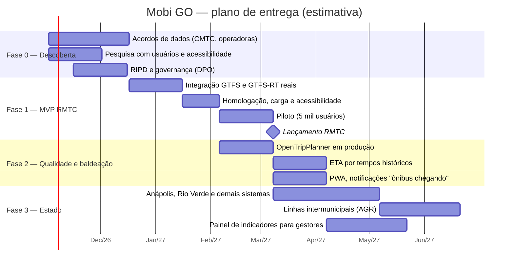

# 09 — Roadmap e plano de entrega

## 1. Fases

| Fase | Entregas | Critério de saída |
|---|---|---|
| **0 — Descoberta** | Termo de cooperação para dados (GTFS + GTFS-RT ou API de AVL); validação das personas; RIPD; decisão sobre a relação com o app oficial SiMRmtc | Feed real de homologação disponível |
| **1 — MVP RMTC** *(código base pronto neste repositório)* | Tudo da seção 5.1 da [visão](01-visao-do-produto.md) com dados reais; verificação de e-mail; recuperação de senha; login gov.br | KPIs de piloto: erro mediano da ETA ≤ 120 s, disponibilidade ≥ 99,5%, NPS ≥ 40 |
| **2 — Qualidade** | Baldeação (OTP); ETA com tempos de percurso históricos por faixa horária (Timescale *continuous aggregates*); alertas de serviço (GTFS-RT ServiceAlerts); PWA offline das rotas salvas; push | Erro mediano ≤ 90 s |
| **3 — Estado** | Novos feeds por município; intermunicipal; painel com pontualidade, cobertura de GPS e demanda agregada | ≥ 5 sistemas integrados |

## 2. Backlog priorizado (próximas sprints)

| # | Item | Requisito | Tamanho |
|---|---|---|---|
| 1 | Verificação de e-mail e "esqueci minha senha" | RF-01/RNF-07 | M |
| 2 | Login gov.br (OIDC) | RNF-07 | M |
| 3 | Exportar métricas do ingestor e da API para Prometheus/OpenTelemetry | RNF-12 | P |
| 4 | Consumir GTFS-RT TripUpdates (atrasos informados pela operadora) na ETA | RF-15 | M |
| 5 | Tempos de percurso históricos → `scheduledRunTime` calibrado | KPI de ETA | G |
| 6 | Lista completa dos 246 municípios (API do IBGE no build) | RF-01 | P |
| 7 | Reordenar categorias (arrastar) e ícones | RF-21 | P |
| 8 | "Avise-me quando o ônibus estiver a X min" (Web Push) | Fase 2 | G |
| 9 | Modo alto contraste e fonte ampliada persistentes | RNF-06 | P |
| 10 | Testes E2E Playwright no CI (homologação) | Qualidade | M |

Tamanhos: P ≤ 2 dias, M ≤ 1 semana, G ≤ 2 semanas (1 dev).

## 3. Equipe sugerida (Fases 1–2)

| Papel | Dedicação |
|---|---|
| Product owner (órgão gestor) | 50% |
| Tech lead / arquiteto | 100% |
| Desenvolvedores full-stack | 2 × 100% |
| Engenharia de dados (GTFS / GTFS-RT) | 50% |
| UX/UI com foco em acessibilidade | 50% |
| QA | 50% |
| DevOps/SRE | 50% |
| Encarregado de dados (DPO) | sob demanda |

## 4. Ritos

- Sprints de 2 semanas: planejamento, *daily*, revisão com a área de negócio e retrospectiva.
- Fluxo Git: *trunk-based* com branches curtas, PR com revisão obrigatória e CI verde (template em `.github/pull_request_template.md`).
- Versionamento semântico e CHANGELOG gerado a partir de Conventional Commits.
- Decisões de arquitetura registradas como ADR em `docs/adr/`.
