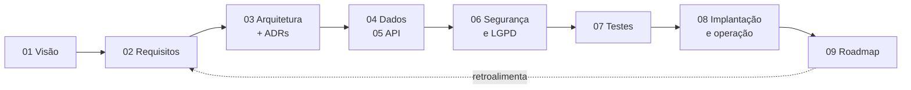

# Documentação do Mobi GO

A documentação segue o ciclo de vida do projeto:

| Fase | Documento |
|---|---|
| Concepção | [01 — Visão do produto](01-visao-do-produto.md) |
| Análise | [02 — Requisitos](02-requisitos.md) |
| Projeto | [03 — Arquitetura](03-arquitetura.md) · [04 — Modelo de dados](04-modelo-de-dados.md) · [05 — API](05-api.md) · [ADRs](adr/) |
| Conformidade | [06 — Segurança e LGPD](06-seguranca-e-lgpd.md) |
| Verificação | [07 — Plano de testes](07-plano-de-testes.md) |
| Implantação e operação | [08 — Implantação e operação](08-implantacao-e-operacao.md) |
| Evolução | [09 — Roadmap](09-roadmap.md) |
| Desenvolvimento | [10 — Guia do ambiente local](10-guia-ambiente-local.md) |
